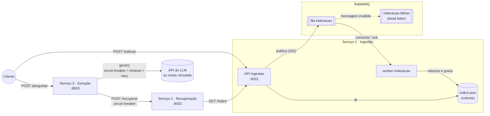

# C2.A2 — RAG Distribuído em Microsserviços

**Sistemas Distribuídos e Computação em Nuvem · FAESA · 2026/2**
Prof. Howard Cruz Roatti · Entrega na Aula 12 (29/10)

**Grupo:** Mateus Reis Dal-Col, Luiz Otávio Kuster, Aidhan Freitas, Henrique Volpini, Vinícius Cavati Gobbi

RAG (geração aumentada por recuperação) responde perguntas com base em documentos
próprios, sem retreinar modelo. O sistema é dividido em **três serviços** com
responsabilidades distintas, uma **fila** para a indexação assíncrona e proteção
contra falhas nas dependências lentas ou instáveis (recuperação e API do LLM).

---

## Arquitetura



| Componente | Responsabilidade | Comunicação |
|---|---|---|
| **ingestao** (`servicos/ingestao/app.py`) | Recebe documentos e serve o índice | REST; publica na fila |
| **worker-indexacao** (`servicos/ingestao/worker.py`) | Vetoriza (TF-IDF) e persiste o índice | Consome a fila |
| **recuperacao** (`servicos/recuperacao/app.py`) | Similaridade do cosseno entre a pergunta e os documentos; devolve os `top_k` | REST |
| **geracao** (`servicos/geracao/app.py`) | Orquestra a pergunta: busca contexto e chama o LLM | REST |
| **rabbitmq** | Fila durável `indexacao` + dead letter `indexacao.falhas` | AMQP |

### Fluxo de indexação (assíncrono, via fila)

1. `POST /indexar` valida os documentos, publica uma mensagem persistente na fila
   `indexacao` (com confirmação do broker) e responde **202 Accepted**.
2. O worker consome uma mensagem por vez, recalcula os vetores de todo o índice
   com o vocabulário novo e grava o arquivo de forma atômica.
3. Só depois de gravar o worker faz `ack`. Se cair antes, o RabbitMQ reentrega;
   documentos repetidos (mesmo texto e origem) são ignorados, então reprocessar
   não duplica o índice.
4. Mensagem malformada recebe `nack` sem reenfileirar e vai para `indexacao.falhas`.

Com o worker parado, a API continua aceitando documentos; eles ficam na fila até
o worker voltar.

### Fluxo de pergunta (síncrono, REST)

1. `POST /perguntar` → geração chama `POST /recuperar` na recuperação.
2. A recuperação busca o índice em `GET /indice`, vetoriza a pergunta e devolve
   os trechos mais similares (trechos com similaridade zero são descartados).
3. Sem trecho relevante, a geração responde sem chamar o LLM. Caso contrário,
   chama o LLM com o contexto e devolve a resposta e os trechos usados.

### Resiliência

| Falha | Comportamento |
|---|---|
| LLM com erro/lento | Timeout de 20 s por tentativa, até 3 tentativas (esperas de 1 s e 2 s) para timeout, conexão e HTTP 408/429/5xx. Erro final: **504** (timeout) ou **502** |
| LLM falhando seguidamente | Circuit breaker abre após 3 gerações com falha: **503** + `Retry-After` por 20 s; depois uma chamada de teste decide se fecha |
| Recuperação fora do ar | Disjuntor próprio na geração: **502** nas 3 primeiras falhas, depois **503** imediato por 20 s |
| Ingestão fora do ar | Recuperação responde **502/504**, contados pelo disjuntor da geração |
| RabbitMQ fora do ar | `/indexar` tenta 3 vezes e responde **503**; o worker reconecta sozinho a cada 3 s |
| Worker cai no meio | Mensagem sem `ack` é reentregue; consumo idempotente |
| Sem chave de API / sem internet | Modo simulado do LLM: resposta montada a partir do contexto recuperado |

Os circuitos são por processo. O estado deles aparece em `GET /saude` da geração.

---

## Como executar

### Com Docker (recomendado)

Requer Git e Docker com o plugin Compose.

```bash
git clone https://github.com/ReisDC/sd-2026-2-kit-c2a2.git
cd sd-2026-2-kit-c2a2
cp .env.example .env          # opcional: preencha LLM_API_KEY; vazio = modo simulado
docker compose up -d --build
docker compose ps             # rabbitmq deve ficar "healthy"
```

Portas: ingestão `8001`, recuperação `8002`, geração `8003`, RabbitMQ `5672` e
painel de gerenciamento em http://localhost:15672 (guest/guest).
O índice fica no volume `indice` e sobrevive à recriação dos containers.

### Sem Docker

Depois de clonar o repositório (passo acima), requer Python 3.12 (as versões fixadas no
`requirements.txt` não têm pacotes para 3.14)
e um RabbitMQ rodando:

```bash
python -m venv .venv
source .venv/bin/activate            # Windows: .venv\Scripts\activate
pip install -r requirements.txt
docker run -d --name rabbitmq -p 5672:5672 rabbitmq:3.13-alpine

# um terminal para cada processo
uvicorn servicos.ingestao.app:app    --port 8001
python -m servicos.ingestao.worker
uvicorn servicos.recuperacao.app:app --port 8002
uvicorn servicos.geracao.app:app     --port 8003 --env-file .env
```

As variáveis de configuração estão em `.env.example`.

### Usando

```bash
# Indexar (resposta 202: o worker processa em segundo plano)
curl -X POST http://localhost:8001/indexar -H "Content-Type: application/json" -d '[
  {"texto": "O teorema CAP afirma que, diante de uma particao de rede, um sistema distribuido precisa escolher entre consistencia e disponibilidade.", "origem": "teorema_cap.txt"},
  {"texto": "Raft e um algoritmo de consenso baseado em eleicao de lider e log replicado.", "origem": "consenso_raft.txt"}
]'

curl http://localhost:8001/saude      # {"status":"ok","documentos":2}

# Perguntar
curl -X POST http://localhost:8003/perguntar -H "Content-Type: application/json" \
  -d '{"pergunta": "o que diz o teorema CAP?"}'
```

Os textos de exemplo completos estão em `documentos/`.

---

## Testes

Sem chave de API, sem broker e sem chamadas externas:

```bash
python -m unittest discover -s tests -v
```

| Arquivo | Cobre |
|---|---|
| `tests/test_resiliencia.py` | Retentativas, timeout, circuit breaker do LLM e da recuperação, modo simulado |
| `tests/test_recuperacao.py` | Ordenação por similaridade, descarte de irrelevantes, validação de `top_k` |
| `tests/test_mensageria.py` | Publicação na fila, worker, idempotência, dead letter, persistência atômica |

---

## Estrutura

```
sd-2026-2-kit-c2a2/
├── servicos/
│   ├── comum/
│   │   ├── circuit_breaker.py  # disjuntor (fechado / aberto / meio-aberto)
│   │   ├── embeddings.py       # vetorização TF-IDF offline
│   │   ├── fila.py             # conexão, filas e publicação no RabbitMQ
│   │   └── llm.py              # cliente do LLM com retry e modo simulado
│   ├── ingestao/
│   │   ├── app.py              # API: /indexar (publica) e /indice
│   │   ├── worker.py           # consumidor da fila de indexação
│   │   ├── indice.py           # persistência do índice
│   │   └── modelos.py
│   ├── recuperacao/app.py      # busca por similaridade
│   └── geracao/app.py          # orquestração e chamada ao LLM
├── tests/
├── documentos/                 # base de teste
├── Dockerfile                  # imagem única para todos os processos
├── docker-compose.yml
└── TAREFAS.md
```

---

## Aulas de referência

- **Aula 6** — IA como serviço (embedding, inferência, LLM)
- **Aula 8** — Mensageria, eventos e API Gateway
- **Aula 10** — Replicação, consistência e CAP
- **Aula 11** — Consenso (Raft) e resiliência: circuit breaker
